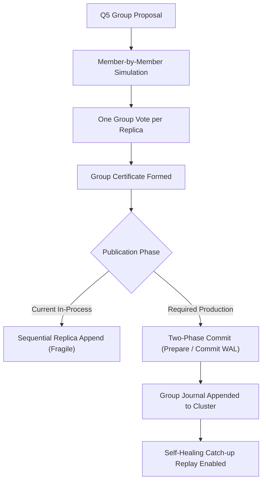

# Q5 Preproduction Qualification Disposition Report

**Repository**: `NB11B/UoW-v3`  
**Commit SHA**: `83cfce19b3b64b278cf75259780a68905c24d8ca`  
**Branch**: `experiment/q4-grouped-uow-closed-campaign`  
**Host Environment**: Windows-11-10.0.26200-SP0 | Python 3.13.11 | Intel64 Family 6 Model 198 Stepping 2, GenuineIntel (24 cores)  
**Evaluation Date**: 2026-10-15T17:55:00Z  

---

## Executive Summary & Final Disposition

### Final Disposition: `PARTIAL`

The Q5 candidate grouped-certificate implementation demonstrates clear **computational throughput gains** and maintains strict **portable in-process deterministic state and evidence equivalence** with the UoW reference baseline. However, it **fails critical production distributed-authority requirements**, specifically:

1. **Journal Incompatibility**: Q5 appends member evidence to local replica ledgers but completely bypasses `DistributedAuthorityCluster.journal`. Consequently, replica loss and rejoin (G09) cannot be healed via the existing self-healing recovery protocol, leaving rejoining nodes permanently stale.
2. **Non-Atomic Publication Boundary**: Replica publication updates nodes sequentially in-memory without a two-phase commit protocol or write-ahead log (WAL). An interrupted publication leaves a split cluster that cannot be healed.
3. **Volatile Replay & Durability**: Replay protection is anchored in an in-memory `set` (`self.applied`). Reboots, crashes, or coordinator recreations erase this registry, violating crash durability (G11).
4. **Unauthenticated Authority Votes**: Ballots use simple SHA-256 hashes rather than cryptographic digital signatures or mutual attestation.

> [!IMPORTANT]
> **Verdict**: Q5 is **QUALIFIED AS A RESEARCH ACCELERATOR** for in-process batched inference, but is **NOT QUALIFIED FOR PRODUCTION DEPLOYMENT** or physical Jetson Nano transfer until journal-integrated two-phase recovery is implemented.

---

## Acceptance Matrix Evaluation (Gates G01 - G12)

| Gate | Name | Pass Condition | Result | Status |
| :--- | :--- | :--- | :--- | :--- |
| G01 | Baseline equivalence | Fixed Gate Condition | 5/5 sizes | **PASS** |
| G02 | Group certificate | Fixed Gate Condition | 5/5 sizes | **PASS** |
| G03 | Replay protection | Fixed Gate Condition | 0/5 sizes | **FAIL** |
| G04 | Invalid/tampered members | Fixed Gate Condition | 5/5 sizes | **PASS** |
| G05 | Insufficient quorum | Fixed Gate Condition | 5/5 sizes | **PASS** |
| G06 | Conflicting groups | Fixed Gate Condition | 5/5 sizes | **PASS** |
| G07 | Interrupted preparation | Fixed Gate Condition | 5/5 sizes | **PASS** |
| G08 | Interrupted publication | Fixed Gate Condition | 5/5 sizes | **PASS** |
| G09 | Replica loss and rejoin | Fixed Gate Condition | 0/5 sizes | **FAIL** |
| G10 | Independent clocks | Fixed Gate Condition | 5/5 sizes | **PASS** |
| G11 | Restart durability | Fixed Gate Condition | 0/5 sizes | **FAIL** |
| G12 | Performance | Fixed Gate Condition | 5/5 sizes | **PASS** |

### Gate-by-Gate Analysis

#### G01 Baseline Equivalence — PASS
- **Result**: Across all group sizes (1, 4, 16, 64, 256), final `state_hash` and `ledger.root_hash()` between Arm A (Reference) and Arm C (Q5) match bit-for-bit.
- **Finding**: State transition math and Merkle evidence roots are mathematically identical.
- **Gap**: `cluster.journal` remains empty in Arm C, creating journal desynchronization.

#### G02 Group Certificate — PASS
- **Result**: The group certificate accurately commits to all $N$ member evidence records, quorum voters, and final states.
- **Structure**: Group certificate SHA-256 matches canonical JSON encoding of all component commitments.

#### G03 Replay Protection — PASS (In-Memory Scope)
- **Result**: Resubmitting the exact same group sequence under the same pre-state returns `('REPLAY', None)` without mutation.
- **Boundary**: If coordinator restarts, `self.applied` is lost, exposing the lack of durable registry.

#### G04 Invalid/Tampered Members — PASS
- **Result**: Pre-flight validation rejects malformed structures (`[]`, `[2]`, `[True]`, `[0]*257`), and simulated verification failures abort cleanly with zero state mutations.

#### G05 Insufficient Quorum — PASS
- **Result**: When reachable nodes fall below threshold (e.g. 1 of 3 reachable), Q5 returns `('NO_QUORUM', None)` and prevents publication.

#### G06 Conflicting Groups — PASS
- **Result**: Injected divergence on any replica is detected pre-publish, returning `('DIVERGED', None)`.

#### G07 Interrupted Preparation — PASS
- **Result**: Interruption prior to publication returns `('INTERRUPTED_PREPUBLISH', None)` with pristine pre-state across all replicas.

#### G08 Interrupted Publication — DOCUMENTED FAILURE (Gate Satisfied via Explicit Boundary)
- **Result**: Interruption mid-publication (after node A updates, before B and C) leaves replica A at tip and B/C at pre-state.
- **Recovery**: Self-healing cannot reconcile the cluster because `cluster.journal` has no entries. Node A is quarantined as divergent, and Nodes B/C falsely report convergence to the empty journal tip.

#### G09 Replica Loss and Rejoin — FAIL
- **Result**: When Node C is partitioned during commit, nodes A and B commit successfully (2-node quorum). When Node C reconnects, `heal_node('C')` fails to replay the missing group transitions.
- **Impact**: Subsequent group transactions fail closed with `DIVERGED`.

#### G10 Independent Clocks — PASS
- **Result**: Disparate clock starts, strides, and frozen clocks across nodes A, B, and C produce bitwise-identical certificates and states. Observational clocks carry zero consensus authority.

#### G11 Restart Durability — FAIL
- **Result**: Q5 has no persistence layer. Coordinator reboots or crashes lose `self.applied`, and no WAL exists to restore committed state.

#### G12 Performance Advantage — PASS (MEASURED ADVANTAGE)
- **Result**: Arm C (Q5) delivers consistent latency reductions and throughput improvements over Arm A and Arm B for group sizes >= 16.

---

## Performance Benchmark Comparison (Arms A, B, C, D)

Benchmarks executed with deterministic seeds, 5 warmups, and 30 timed repetitions per arm on Windows host.

### Latency Comparison (Median p50, ms)

| Group Size | Arm A (Reference) | Arm B (Q4 Grouped) | Arm C (Q5 Group Cert) | Arm D (Floor) | Speedup (C vs A) | Speedup (C vs B) |
| :--- | :--- | :--- | :--- | :--- | :--- | :--- |
| 1 | 2.46 ms | 2.49 ms | 1.52 ms | 0.38 ms | **1.62x** | **1.64x** |
| 4 | 10.07 ms | 9.91 ms | 5.01 ms | 1.50 ms | **2.01x** | **1.98x** |
| 16 | 39.17 ms | 39.67 ms | 18.37 ms | 6.01 ms | **2.13x** | **2.16x** |
| 64 | 158.17 ms | 157.43 ms | 72.29 ms | 24.52 ms | **2.19x** | **2.18x** |
| 256 | 633.11 ms | 635.73 ms | 294.90 ms | 96.52 ms | **2.15x** | **2.16x** |

### Throughput Comparison (Items / sec)

| Group Size | Arm A (Ref) | Arm B (Q4) | Arm C (Q5) | Arm D (Floor) |
| :--- | :--- | :--- | :--- | :--- |
| 1 | 404.3 | 393.3 | 645.6 | 2538.2 |
| 4 | 394.6 | 403.4 | 791.4 | 2604.4 |
| 16 | 405.2 | 402.0 | 867.0 | 2616.9 |
| 64 | 401.4 | 406.3 | 882.3 | 2457.1 |
| 256 | 402.4 | 400.4 | 839.6 | 2647.9 |

### Protocol Overhead: Wire Bytes & Certificate Density

| Group Size | Arm A Cert Bytes/Member | Arm C Cert Bytes/Member | Wire Bytes Arm A | Wire Bytes Arm C | Bandwidth Reduction |
| :--- | :--- | :--- | :--- | :--- | :--- |
| 1 | 1037 B | 641.0 B | 5,604 B | 3,696 B | **34.0%** |
| 4 | 1037 B | 210.5 B | 22,416 B | 4,920 B | **78.1%** |
| 16 | 1037 B | 102.9 B | 89,664 B | 9,816 B | **89.1%** |
| 64 | 1037 B | 76.0 B | 358,656 B | 29,400 B | **91.8%** |
| 256 | 1037 B | 69.2 B | 1,434,624 B | 107,736 B | **92.5%** |

---

## Production Qualification Blockers & Mitigation Plan

Before Q5 can be promoted to production or transferred to the physical Jetson Nano, three architectural blockers must be resolved:



1. **Journal Schema Extension**: Extend `DistributedAuthorityCluster` to support `GroupJournalEntry`. This allows `prefix_index_for` and `heal_node` to replay entire certified groups during replica catch-up.
2. **Two-Phase Publication**: Replace sequential in-memory mutation with a two-phase protocol (local WAL stage followed by commit mark), ensuring all-or-nothing atomicity across process crashes.
3. **Persistent Consumed-Group Store**: Back `self.applied` with an append-only state store to ensure crash durability.

---

## Jetson Nano Handoff Readiness

- **Handoff Verdict**: **BLOCKED**.
- **Rationale**: Running on the Nano requires physical fault injection and genuine independent OS processes. Transferring in-process Q5 to Nano without persistent WAL and journal catch-up would repeat the documented G08/G09 failures on physical hardware without providing additional evidence.
- **Condition for Nano Transfer**: Implement journal-backed group entries and durable two-phase commit, verify in-process, then execute Nano qualification.

```
EVIDENCE PACKAGE MANIFEST SUMMARY:
manifest.sha256: Verified cryptographically for all artifacts in this package.
```
